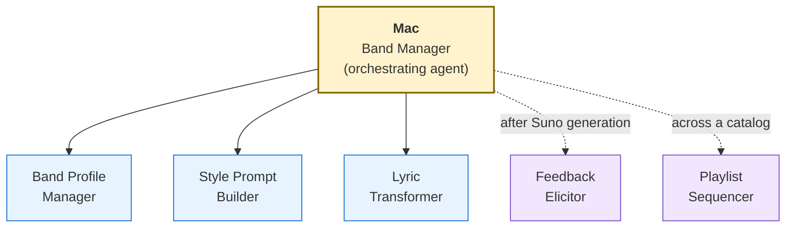

# Suno Agent — Mac, the Band Manager

> **Created with the [BMad Method](https://github.com/bmad-code-org/BMAD-METHOD/).** A BMad module, built and reviewed with BMad's Toolsmith and measured with `bmad-eval` — see [Credits](#credits).

An AI-powered music production assistant that helps you create professional Suno-ready song packages through guided creative conversation. Mac orchestrates five specialized skills into a seamless workflow: from initial inspiration to a complete package — style prompt, lyrics, and parameter recommendations — that you can paste directly into Suno.

## Features

You talk to Mac like you'd talk to a producer. Tell Mac what kind of song you want — a genre, a mood, a poem, a feeling, a reference track — and Mac produces a complete package:

- **Style Prompt** — Model-specific, optimized for your chosen Suno model (v6, v6-wild, v6-mini)
- **Structured Lyrics** — With Suno metatags (`[Verse]`, `[Chorus]`, etc.), rhythmic consistency, and cliché detection
- **Exclusion Prompt** — What Suno should avoid
- **Parameter Recommendations** — Slider values, vocal gender, persona references (tier-aware)
- **Wild Card Variant** — An experimental alternative to push creative boundaries

After you try the output on Suno, Mac helps you refine through a structured feedback loop — translating subjective reactions ("it doesn't feel right") into concrete parameter adjustments.

### Highlights

- **Three Interaction Modes** — Demo (quick and scrappy), Studio (deep customization), Jam (experimental)
- **Band Profiles** — Persistent sonic identity across songs (genre, vocal direction, style baseline, writer voice)
- **Multi-Band Support** — Run multiple bands in one project, each with its own canonical playlist and analysis (per-band YAML files keep sequence data independent and drift-free)
- **Writer Voice Preservation** — Analyzes your writing samples to maintain your authentic voice when transforming lyrics
- **Tier-Aware** — Knows what's available on Free, Pro, and Premier plans; never shows features you can't access
- **Feedback Loop** — Five-type feedback triage with guided elicitation for users who can't articulate what's wrong
- **Playlist Sequencing & Album Craft** — Camelot wheel transitions, felt-BPM corrections, energy arc / W-shape analysis, locked-arc preservation, narrative-aware ordering across the full per-band catalog
- **Audio Analysis Toolkit** — Per-song deep analysis (BPM, key, energy arc, chord progression, section boundaries) with a JSON archive layer so you never re-run the same analysis twice, and auto-refreshed Markdown summary docs per band
- **Multi-Machine Workflow** — Portable sync archive moves your songbook, profiles, playlists, and analysis between machines; an audio-file manifest with size-tolerance + filename-normalization verification flags genuine gen differences without false-positiving Suno's per-download metadata variance
- **Instrumental Support** — Dedicated workflow for instrumental-only tracks
- **Non-English Support** — Language detection with Suno-specific guidance
- **Memory System** — Remembers your preferences, musical patterns, and creative history across sessions

## Quick Start

1. **Invoke Mac** — Use the trigger phrase "talk to Mac," "Band Manager," or "create a song for Suno"
2. **Tell Mac what you want** — "Make me a sad indie folk song" or paste a poem
3. **Get your package** — Mac produces a complete style prompt + lyrics + parameters
4. **Try it on Suno** — Paste into Suno's Custom Mode fields
5. **Come back and refine** — Tell Mac what worked and what didn't

For detailed documentation on all features, interaction modes, band profiles, the feedback loop, direct skill access, and headless/automation modes, see the [Usage Guide](USAGE.md).

## Architecture

Mac is an orchestrating agent that coordinates five specialized skills — three pre-generation, two post-generation. A sixth folder, `bmod-suno`, is the module record that BMad's `bmad setup` reads:



The orchestrating agent and each skill have their own documentation:

| Component | Purpose | Key Scripts |
|-----------|---------|-------------|
| [**Mac (Band Manager)**](USAGE.md) | Orchestrating agent — guides the full song creation workflow across all skills | `pre-activate.py` (the wake: `--wake`, `--pulse`), `validate-sidecar.py`, `songbook-catalog.py`, `find-stale-refs.py`, `upgrade-sanctum.py`, `check-memory-health.py`, `validate-path.py`, `configure-guard.py` (installs the pipeline guard) |
| [**Band Profile Manager**](src/skills/suno-band-profile-manager/SKILL.md) | CRUD for band identity profiles, writer voice analysis, tier feature awareness, per-band playlist YAML | `apply-profile.py`, `validate-profile.py`, `list-profiles.py`, `tier-features.py`, `diff-profiles.py`, `scaffold-playlist.py` |
| [**Style Prompt Builder**](src/skills/suno-style-prompt-builder/SKILL.md) | Model-aware style prompt generation with creativity modes and wild card variants | `validate-prompt.py` |
| [**Lyric Transformer**](src/skills/suno-lyric-transformer/SKILL.md) | Poem/text to Suno-ready structured lyrics with metatags and cliché detection | `validate-lyrics.py`, `cliche-detector.py`, `syllable-counter.py`, `analyze-input.py`, `section-length-checker.py`, `lyrics-diff.py`, `spacing-check.py` (the writer's spacing survives verbatim), `validate-options.py`, `assemble-summary.py` |
| [**Feedback Elicitor**](src/skills/suno-feedback-elicitor/SKILL.md) | Post-generation feedback triage and guided refinement with musical vocabulary translation. Also hosts the audio-analysis toolkit and multi-machine audio verification scripts | `parse-feedback.py`, `map-adjustments.py`, `feedback-log.py`, `analyze-audio.py`, `audio-deep-analysis.py`, `chord-progression.py`, `tempo-detail.py`, `beat-grid.py`, `vocal-placement.py`, `section-map.py`, `audio-files-manifest.py`, `verify-audio-files.py` |
| [**Playlist Sequencer**](src/skills/suno-playlist-sequencer/SKILL.md) | Album-craft track ordering: energy arcs, key moves, locked arcs, encore design | `playlist-sequencing-data.py`, `batch-full-analysis.py`, `validate-sequence.py` |
| **Module record** (`src/skills/bmod-suno/`) | BMad v7 record: `bmod.toml` (module code `suno`, version, update source, the five setup questions), `roster.toml` (Mac), `help/` (what `bmad` tells users about the module), `retired.toml` (retires `suno-setup`) | — |

Each skill (not the module record) can be invoked directly for standalone use — see the linked `SKILL.md` files (each routes to its references, including its headless contract) and [USAGE.md](USAGE.md).

### Per-band playlist sequencing methodology

Each band has a canonical `docs/{band-slug}-playlist.yaml` as its single source of truth. The `playlist-sequencing-data.py` script reads it and produces:

- A persistent JSON archive at `docs/audio-analysis/playlists/{band-slug}.json` (durable raw data — read it directly to answer different questions of the same audio without re-running)
- An auto-refreshed Markdown summary at `docs/{band-slug}-playlist-sequencing.md` (Camelot key moves rated `key_compat` compatible / near / distant — the key relationship only — plus the BPM change, the loudness step, energy levels and intro/outro percentages, each read separately)

The album-craft methodology (per-track variables, energy arc models including W-shape, key positions, locked-arc preservation, sonic palette variety, encore structure) is documented at [`src/skills/suno-playlist-sequencer/references/playlist-sequencing-methodology.md`](src/skills/suno-playlist-sequencer/references/playlist-sequencing-methodology.md). Multi-band projects keep each band's playlist independent — there's no shared global file that drifts between bands.

For multi-machine projects, `audio-files-manifest.py` generates a small `docs/audio-files-manifest.yaml` (audio MP3s are too large to ship in the sync archive) and `verify-audio-files.py` runs on the receiving machine after sync-unpack to flag missing / wrong-gen / extra files. The verifier is filename-normalization-aware (`Foo.mp3` ≡ `Foo-v2.mp3` ≡ `Foo (NSFW).mp3` for song-identity matching) and size-tolerance-aware (absorbs Suno's per-download ID3 metadata variance so identical-audio doesn't false-positive as different gen).

## Prerequisites

- **An LLM CLI with skill support** — Claude Code, Gemini CLI, Codex CLI, GitHub Copilot, Windsurf, or OpenCode
- **[`uv`](https://docs.astral.sh/uv/)** — the module's Python scripts run via `uv run`, which reads each script's [PEP 723](https://peps.python.org/pep-0723/) inline metadata and auto-provisions dependencies (no virtualenv or manual `pip install`). Install with `curl -LsSf https://astral.sh/uv/install.sh | sh` or `pip install uv`. Dependency-free scripts can fall back to plain `python3` (3.11+) if needed.
- **Suno account** (free tier works; Pro/Premier unlocks additional features). The module targets Suno's **v6 family** (v6, v6-wild, v6-mini).

### Requirements at a glance

| Component | Requirement | Notes |
|---|---|---|
| `uv` | Any recent release (tested on 0.12) | Provisions every script's dependencies from its PEP 723 header. Keeping it current helps: `uv self update` |
| Python — core scripts | 3.11+ | Most scripts are dependency-free or need only `pyyaml` ≥ 6.0 |
| Python — audio analysis | **3.12+** | Required by librosa 1.0; `uv run` downloads a suitable Python on its own if your system one is older |
| Audio libraries | `librosa` ≥ 1.0, `numpy` ≥ 2.1, `pyloudnorm` ≥ 0.2 | Optional — only for the audio-analysis and playlist-sequencing scripts; auto-provisioned by `uv run` |
| Optional heavy tools | PyTorch ≥ 2.1 with `beat-this` ≥ 1.1 (`beat-grid.py`) `demucs` ≥ 4.0.1 (`vocal-placement.py`), or `demucs` plus `faster-whisper` ≥ 1.1 (`section-map.py`) | Opt-in only — nothing else pulls them in. First run provisions 1–3 GB plus the model weights; a CUDA GPU helps (Demucs on CPU takes minutes per track) |
- **BMad Method v7** (the standard setup) — BMad's `bmad` skill, version 6.13.0-next or later (v7 is published under that version string; this release is built on that early v7 build), sets the module's answers (`bmad setup suno`), checks for updates, and answers "what next?" questions. The skills also run without it, on their default answers — see [Standalone, without BMad](#standalone-without-bmad). BMad v6 (6.12 and earlier) is not supported from module 4.0.0

### Optional: Audio Analysis

For objective audio measurements, the audio scripts use `librosa`, `numpy`, and `pyloudnorm`. Running them via `uv run` provisions them automatically — no manual step (they need Python 3.12+, which `uv` fetches if your system Python is older). Only when running without `uv` do you install them by hand:

```bash
pip install librosa numpy pyloudnorm
```

This unlocks:

- **Per-song deep analysis** — BPM, key (Krumhansl-Kessler), energy arc, chord progression, section boundaries, spectral balance
- **Loudness (ITU-R BS.1770)** — integrated LUFS and loudness range per track, plus loudness by thirds
- **Playlist sequencing** — Camelot key moves (compatible / near / distant, rating the key relationship only), entry/exit keys, intro/outro energy, the BPM change, and the loudness step across every seam, for the full per-band playlist
- **Catalog-wide batch analysis** — tempo stability, dynamic character (FLAT / MODERATE / DYNAMIC / HIGHLY-DYNAMIC), energy shifts >20%, section boundary detection across every track at once
- **JSON archive layer** — every analysis is persisted to `docs/audio-analysis/{songs,playlists,catalog}/` so future sessions read the archive instead of re-running the script
- **Auto-refreshed Markdown summaries** — each script writes a human-readable companion doc (per-band for playlist sequencing, catalog-wide for the others) that auto-refreshes between AUTOGEN markers; hand-curated content outside the markers is preserved
- **Multi-machine audio file verification** — `audio-files-manifest.py` + `verify-audio-files.py` close the audio-drift gap when MP3s are too large to ship in the portable sync archive

Three further tools are opt-in because they need PyTorch: **`beat-grid.py`** (Beat This! neural beat and downbeat tracking — a second opinion on tempo and bar grouping), **`vocal-placement.py`** (Demucs stem separation — how loud the voice sits against the band), and **`section-map.py`** (Demucs plus Whisper — lines a render up with its lyrics to show when each tagged section lands and how it sounds). Run them through `uv run` like the others; the first run provisions PyTorch and downloads the model weights. Turn on **PyTorch audio tools** with `bmad setup suno` and the other audio scripts take their tempo from Beat This! instead of librosa; leave it off and they stay librosa-only.

First run provisions PyTorch (about 3 GB with the CUDA build) and downloads the model weights (the Beat This! checkpoint; about 80 MB for Demucs htdemucs). **GPU:** on Linux and WSL, PyPI's current PyTorch build targets CUDA 13, which needs NVIDIA driver 580 or newer; with an older driver (or no NVIDIA GPU) the tools fall back to CPU automatically. Native Windows gets PyPI's CPU-only PyTorch build (use WSL for the GPU), and Apple Silicon Macs run on CPU. **Intel Macs are not supported** for these tools: PyTorch's last Intel-Mac build predates numpy 2, which librosa 1.0 requires. On CPU, Beat This! takes a few seconds per track; Demucs takes minutes. Demucs's first run may print an "unauthenticated requests to the HF Hub" warning — harmless.

These are all optional — the full song creation and refinement workflow works without any of them. Mac will offer to help install if you try to use audio analysis features without them.

## Installation

**Two setups.** The standard is to install it **as a BMad module**: BMad's `bmad` skill asks your setup answers once (plan, mode, folders) and every skill reads them, teams and individuals can layer their own overrides, `bmad` explains the module and suggests next steps from its help files, and it handles updates. The skills also run **standalone**, on their default answers, without BMad. Either setup installs from a clone, with `npx skills`, or as a plugin:

| | As a BMad module (standard) | Standalone |
|---|---|---|
| From a clone | Clone, `./link-skills.sh`, install the `bmad` skill, `bmad setup suno` | Clone, `./link-skills.sh` |
| `npx skills` | `npx skills add bmad-code-org/BMAD-METHOD --skill bmad`, `npx skills add zarlor/suno-band-manager`, `bmad setup suno` | `npx skills add zarlor/suno-band-manager` |
| Plugin (Claude Code, Codex) | The `suno-band-manager` plugin plus BMad's `bmad-core-tools` plugin, then `bmad setup suno` | The `suno-band-manager` plugin |

The full comparison, with what each setup gives you, is in [INSTALLATION.md → Choose your setup](INSTALLATION.md#choose-your-setup).

### From a clone (any supported LLM CLI)

```bash
git clone https://github.com/zarlor/suno-band-manager.git
cd suno-band-manager
./link-skills.sh
```

The link script creates symlinks in `.claude/skills/`, `.agents/skills/` and `.gemini/skills/` — `.agents/skills/` is the portable [Agent Skills](https://agentskills.io) standard supported by Claude Code, Gemini CLI, Codex CLI, GitHub Copilot, Windsurf, and OpenCode. It links the six skills and the `bmod-suno` module record. A clone also gives you the top-level `scripts/` folder that multi-machine sync needs.

### Configure with BMad (standard setup; standalone skips this)

Setup belongs to BMad's `bmad` skill. Install it if your project doesn't have it yet:

```bash
npx skills add bmad-code-org/BMAD-METHOD --skill bmad
```

Then ask it to set up the module:

```
bmad setup suno
```

It asks five questions:

| Answer | Values | Default |
|---|---|---|
| `suno_tier` | `free`, `pro`, `premier` | `free` |
| `default_mode` | `demo`, `studio`, `jam` | `demo` |
| `pytorch_audio_tools` | `on`, `off` | `off` |
| `band_profiles_folder` | a folder path (holds `{project-root}`) | `{project-root}/docs/band-profiles` |
| `songbook_folder` | a folder path (holds `{project-root}`) | `{project-root}/docs/songbook` |

The answers go to `_bmad/config.toml` under `[modules.suno]`. Team overrides go in `_bmad/custom/config.toml` and personal ones in `_bmad/custom/config.user.toml`. Skipping setup is fine: every skill falls back to the defaults above.

Then activate Mac using your LLM CLI's skill invocation (e.g., `/suno-agent-band-manager` in Claude Code). Mac learns the rest — your name, how you like to work, your bands — as you go.

### Without a clone (`npx skills`)

BMad v7 installs modules with the `skills` CLI. To install the module straight from GitHub:

```bash
npx skills add zarlor/suno-band-manager
```

As a BMad module, install the `bmad` skill first (above), select the six `suno-*` skills and `bmod-suno`, then run `bmad setup suno`. Standalone, select the six `suno-*` skills and skip setup. This route doesn't bring the top-level `scripts/` folder; see [INSTALLATION.md](INSTALLATION.md) "Multi-Machine Sync" if you need it.

For per-tool notes, the pipeline guard, and troubleshooting, see [INSTALLATION.md](INSTALLATION.md).

### As a plugin (Claude Code, Codex)

The repository is also a plugin marketplace, the way BMad ships its own modules. In Claude Code (2.1.275 or later):

```
/plugin install suno-band-manager --marketplace zarlor/suno-band-manager
```

In Codex: `codex plugin marketplace add zarlor/suno-band-manager`, then install `suno-band-manager` (the Codex manifest is untested so far). For the BMad module setup, also install BMad's `bmad-core-tools` plugin from `bmad-code-org/bmad-plugins` and run `bmad setup suno`. Use one installation method per skill, and update plugins through the marketplace. Details in [INSTALLATION.md → Installation as a plugin](INSTALLATION.md#installation-as-a-plugin-claude-code-codex).

### Standalone, without BMad

The standard install is as a BMad module, above. The skills also run on their own: install them (clone and `./link-skills.sh`, or `npx skills add zarlor/suno-band-manager`) and skip the `bmad` skill. Every skill then uses the defaults in the setup table, and Mac keeps his memory in `_bmad/memory/suno-agent-band-manager/` all the same (that folder alone doesn't need BMad). Tell Mac your plan and preferred mode in conversation and he remembers them. What you give up: saved setup answers, team and personal overrides (`bmad-customize`), and module help and updates through `bmad`. You can add BMad later and run `bmad setup suno`; nothing needs moving.

### Start using Mac

On first activation, Mac will greet you and confirm your setup. Day-to-day preferences are changeable anytime through conversation — just tell Mac "I upgraded to Pro" or "make Studio my default mode." Ask Mac to "set up the pipeline guard" to make sure no Suno package is assembled without the production skills.

## Updating

### Updating the Suno module

From a clone:

```bash
git pull
```

Your symlinks point into `src/skills/`, so changes are picked up immediately. Rerun `./link-skills.sh` when a release adds or retires a skill; it also removes links to skills that are gone. If you installed with `npx skills`, run `npx skills update` instead, or ask `bmad` to update.

Then run setup again:

```
bmad setup suno
```

It asks only the questions you haven't answered yet and keeps the rest, and it offers to remove retired skills. To change an answer, run it and say which one (for example, "set suno_tier to pro"). Your preferences, band profiles, songbook, and memory are all preserved.

Keep `uv` current too (`uv self update`). After an update that raises an audio dependency, the first audio-script run downloads the new versions into uv's cache on its own. Each release's **Upgrade at a glance** block in [CHANGELOG.md](CHANGELOG.md) lists anything else to do.

### Upgrading from module 3.x (BMad v6)

Module 4.0.0 drops BMad v6 support. Install the `bmad` skill (`npx skills add bmad-code-org/BMAD-METHOD --skill bmad`), pull the module, rerun `./link-skills.sh` (it drops the old `suno-setup` link), and run `bmad setup suno`. The old `_bmad/config.yaml` answers are not read any more, so answer the five questions again. `bmad` offers to remove the retired `suno-setup` skill and other v6 leftovers. On his first waking after the upgrade, Mac converts his memory from `_bmad/_memory/band-manager-sidecar/` to the BMad v7 sanctum at `_bmad/memory/suno-agent-band-manager/`: backup first, the plan shown before anything is written, and the old folder kept until you say to remove it.

## Multi-LLM Compatibility

Mac follows the [Agent Skills](https://agentskills.io) open standard. The `link-skills.sh` script creates symlinks in `.agents/skills/` (the portable standard) alongside `.claude/skills/`:

| LLM CLI | Skill Discovery Path | Status |
|---------|---------------------|--------|
| Claude Code | `.claude/skills/`, `.agents/skills/` | Fully supported |
| Gemini CLI | `.agents/skills/`, `.gemini/skills/` | Compatible |
| Codex CLI | `.agents/skills/` | Compatible |
| GitHub Copilot | `.agents/skills/`, `.github/skills/` | Compatible |
| Windsurf | `.agents/skills/`, `.windsurf/skills/` | Compatible |
| OpenCode | `.agents/skills/`, `.opencode/skills/` | Compatible |
| Cursor | `.cursor/skills/` (copy, not symlink) | Manual setup required |

Mac was developed and tested primarily on Claude Code. Other LLM CLIs should work with the same SKILL.md format but may have differences in tool permissions, agent spawning, or skill activation UX.

## Suno Model Compatibility

Mac builds packages for Suno's **v6 family** — v6, v6-wild, and v6-mini — which replaced every earlier model on 2026-09-09. The v6 guidance in this release is a **preview**, compiled in v6's first week; expect it to firm up in the next major release. Retired model names (v4 through v5.5 Pro) are still recognized in older band profiles and songbook entries and flagged for update. See the [Suno Reference](src/skills/suno-agent-band-manager/references/SUNO-REFERENCE.md) for models, plans, and prompting, and the [Studio & Editor Reference](src/skills/suno-agent-band-manager/references/STUDIO-EDITOR-REFERENCE.md) for post-generation editing (Song Editor, Studio 2.0, stems, and more).

## File Structure

```
src/skills/
├── bmod-suno/                 # BMad v7 module record (not a runnable skill)
│   ├── SKILL.md                    # Metadata stub; never invoked
│   ├── bmod.toml                   # Module code, version, update source, setup questions
│   ├── roster.toml                 # Mac, as offered to BMad's roster
│   ├── retired.toml                # Skills the module no longer ships (suno-setup)
│   └── help/                       # What `bmad` knows about the module: help.md + topic files
├── suno-agent-band-manager/   # Mac — orchestrating agent
│   ├── SKILL.md                    # Lean bootloader — identity seed, activation routing
│   ├── bmod.toml                   # Skill record (every skill has one): module, source, skills it needs
│   ├── customize.toml              # Agent customization surface
│   ├── assets/                     # Sanctum templates seeded at First Breath; menu.csv (Mac's menu)
│   ├── references/
│   │   ├── activation.md           # Waking — identity files, memory map, greeting, menu
│   │   ├── headless.md             # Headless capability runs (routes to the *-headless.md contracts)
│   │   ├── create-song.md          # CS — main song creation workflow
│   │   ├── create-song-headless.md # CS headless input contract and package payload
│   │   ├── refine-song.md          # RS — bring back a take: diagnose, rebuild what changed
│   │   ├── refine-song-headless.md # RS headless input contract and delta payload
│   │   ├── post-publish.md         # The keeper pass: measure, songbook entry, reconcile, index
│   │   ├── browse-songbook.md      # SB — creative history browsing
│   │   ├── save-memory.md          # SM — tending pass and session note
│   │   ├── reconcile.md            # Stale-reference reconciliation
│   │   ├── capability-authoring.md # Authoring a capability the owner teaches Mac
│   │   ├── prompt-quality-canon.md # Outcome-driven prompt quality
│   │   ├── creed.md                # Seed source for the sanctum's creed disciplines (not loaded on waking)
│   │   ├── init.md                 # First Breath — first-run setup
│   │   ├── upgrade-v1.md           # v1 memory store → v2 (then v7 on the next wake)
│   │   ├── upgrade-v2.md           # v2 sanctum → v7 sanctum
│   │   ├── pipeline-guard.md       # Setting up the pipeline guard
│   │   ├── SUNO-REFERENCE.md       # Suno platform reference
│   │   └── STUDIO-EDITOR-REFERENCE.md # Studio 2.0 and Song Editor reference
│   └── scripts/
│       ├── pre-activate.py         # The wake: config, sanctum state, menu (--wake, --pulse)
│       ├── init-sanctum.py         # Scaffolds a fresh sanctum
│       ├── upgrade-sanctum.py      # Updates an existing sanctum from the shipped templates
│       ├── migrate-sidecar-to-v2.py # v1 → v2 migration
│       ├── migrate-sanctum-to-v7.py # v2 → v7 conversion
│       ├── validate-sidecar.py     # Sanctum + catalog parity checks
│       ├── find-stale-refs.py      # Old-value search for reconciliation
│       ├── songbook-catalog.py     # Per-song catalog lookups
│       ├── genre-coverage.py, scan-wip-status.py, reconcile-sidecar.py,
│       │   regenerate-index-sections.py, check-memory-health.py, _sanctum_seed.py
│       ├── pipeline-guard.py       # Stop hook: package pipeline + order guard (runs on bare python3)
│       ├── configure-guard.py      # Installs the guard: AGENTS.md standing order + Claude Code Stop hook
│       └── validate-path.py        # Access boundary check
├── suno-band-profile-manager/ # Band profile CRUD and writer voice analysis
│   ├── references/                 # create-profile, profile-schema, playlist-yaml, tier-features, headless
│   └── scripts/                    # apply-profile, validate-profile, list-profiles, diff-profiles,
│                                   # tier-features, scaffold-playlist, profile_paths, _shared/
├── suno-style-prompt-builder/ # Model-aware style prompt generation
│   ├── references/                 # model-prompt-strategies, safety-tables, retired-model-strategies,
│   │                               # research-sources, interactive-session, headless-contract
│   └── scripts/                    # validate-prompt, _shared/
├── suno-lyric-transformer/    # Poem/text to Suno-ready lyrics
│   ├── references/                 # metatag-reference, section-jobs, interactive-session, headless-contract
│   └── scripts/                    # validate-lyrics, cliche-detector, syllable-counter, analyze-input,
│                                   # section-length-checker, lyrics-diff, spacing-check,
│                                   # validate-options, assemble-summary, _shared/
├── suno-feedback-elicitor/    # Post-generation feedback refinement + audio analysis
│   ├── references/                 # feedback-triage-guide, map-vocals, map-arrangement, map-energy-structure,
│   │                               # map-production-mood, controls, technical-resolution, audio-analysis-scripts,
│   │                               # gemini-audio-analysis, output-template, durable-writes, headless-contract,
│   │                               # retired-models, research-sources
│   └── scripts/                    # parse-feedback, map-adjustments, feedback-log, analyze-audio,
│                                   # audio-deep-analysis, chord-progression, tempo-detail, beat-grid,
│                                   # vocal-placement, section-map, audio-files-manifest,
│                                   # verify-audio-files, _shared/
└── suno-playlist-sequencer/   # Album-craft playlist ordering
    ├── references/                 # playlist-sequencing-methodology, headless-contract
    └── scripts/                    # playlist-sequencing-data, batch-full-analysis, validate-sequence, _shared/
src/_shared/                   # Canonical shared Python helpers (edit here only)
dev-tools/sync-shared.py       # Copies src/_shared/ into each skill's scripts/_shared/ (--check reports drift)
dev-docs/                      # Development records: decision-logs/ (frozen) and memlog/
```

BMad installs each skill folder on its own, so every skill whose scripts need the shared helpers carries a vendored copy in `scripts/_shared/` (among them `bmad_config.py`, which reads the `[modules.suno]` answers from BMad's TOML config layers). The canonical copies live in `src/_shared/`, outside `src/skills/`, because BMad's validator requires every folder under `src/skills/` to be a skill or a module record. Edit `src/_shared/` and run `uv run dev-tools/sync-shared.py`; a test fails if a copy drifts.

## License

MIT — see [LICENSE](LICENSE) for details.

## Credits

Created with the [BMad Method](https://github.com/bmad-code-org/BMAD-METHOD/) — Build More, Architect Dreams. Mac's agent architecture, skill structure, and module system are powered by BMad's framework and its Toolsmith (`bmad-toolsmith`) and `bmad-eval` tools. The skills run on their defaults without BMad, but the module owes its DNA to BMad's approach to outcome-driven AI agent design.
